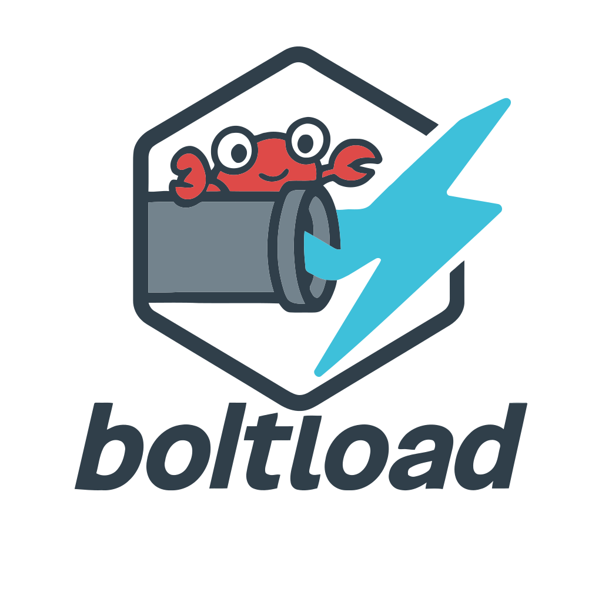

<p align="center">
    
</p>

<h3 align="center">High-performance, runtime-agnostic download engine for Rust</h3>

<div align="center">

[](https://github.com/greenhat616/bolt-load/actions/workflows/ci.yml)
[](https://deepwiki.com/greenhat616/bolt-load)


</div>

---

**bolt-load** is an embeddable Rust library for single-stream and multi-stream concurrent file downloads. It automatically detects HTTP range support, splits files into parallel byte-range chunks, and dynamically rebalances slow connections — all while staying runtime-agnostic.

## Highlights

- **Pluggable adapters** — bring any download source via the `BoltLoadAdapter` trait; ships with reqwest and ureq.
- **Multi-runtime** — Tokio, Smol out of the box; custom runtimes via traits.
- **Adaptive concurrency** — failure-rate monitoring with automatic degradation and recovery.
- **Dynamic range splitting** — slow runners have their remaining ranges reassigned in real time.
- **Multiple I/O backends** — mmap, pwrite thread pool, compio writer.
- **Backpressure-aware** — lock-free SPSC ring-buffer channels prevent memory blow-up.
- **Structured errors** — retryable vs. unretryable classification drives intelligent retry logic.
- **Resumable downloads** — with `Resume::On`, an unfinished download keeps its blocks, checked by CRC32C on resume, and a later task downloads only the rest (see the [crate README](crates/bolt-load/README.md#resuming)).
- **Observable** — EMA speed sampling, progress events, `indicatif` progress bars, `tracing` spans.

## Quick Start

Add to your `Cargo.toml`:

```toml
[dependencies]
bolt-load = "0.2"
reqwest = "0.13"
indicatif = "0.18"
tokio = { version = "1", features = ["full"] }
```

Download a file with concurrent range requests and a terminal progress bar:

```rust,ignore
use bolt_load::task::Task;
use bolt_load::adapter::reqwest::IntoReqwestAdapter;
use bolt_load::runtime::ThreadedRuntimeImpl;

#[tokio::main]
async fn main() -> anyhow::Result<()> {
    let client = reqwest::Client::new();
    let adapter = client.into_reqwest_adapter((
        reqwest::Method::GET,
        "https://example.com/large-file.bin".parse()?,
    ));

    let task = Task::builder(adapter)
        .runtime(ThreadedRuntimeImpl::new_tokio_rt())
        .save_to("large-file.bin")
        .spawn()?;

    task.drive_progress_bar(indicatif::ProgressBar::no_length());
    let output = task.await?;
    println!("saved {} bytes to {:?}", output.progress.downloaded, output.path);

    Ok(())
}
```

`task.status()` is a latest-value receiver of `TaskStatus` snapshots (state,
progress, speed) for your own UI; dropping the `Task` cancels the download.

## Architecture

```text
┌──────────────────────────────────────────────────────┐
│                       Task                           │
│  ┌──────────────────┐   ┌──────────────────────────┐ │
│  │  Singleton mode   │   │    Concurrent mode       │ │
│  │  (1 runner)       │   │    (N runners)           │ │
│  └────────┬─────────┘   └────────┬─────────────────┘ │
│           │                      │                    │
│           ▼                      ▼                    │
│       TaskRunner[]         RunnerManager              │
│           │                ├─ ChunkPlanner            │
│           │                ├─ StrategyControl         │
│           │                ├─ SpeedSampler            │
│           │                └─ FileWriter              │
│           ▼                                           │
│       AnyAdapter (BoltLoadAdapter trait)               │
└──────────────────────────────────────────────────────┘
```

**Task** is the user-facing entry point. It selects between two download strategies automatically:

| Mode | Condition | Behavior |
|------|-----------|----------|
| **Singleton** | Adapter lacks range support | Single `TaskRunner`, sequential stream |
| **Concurrent** | Adapter supports byte ranges | N parallel `TaskRunner`s with dynamic splitting |

### Concurrency Control

The engine sets its connection limit from evidence, not failure rates:

1. **Start** — spawn up to `max_connections` runners (8 by default, whatever the CPU count; `TaskBuilder::max_connections`).
2. **Lower** — three refused connects in a row, while the runners already
   connected keep delivering, lower the limit to those runners; a congestion
   response (429/503) lowers it to the runners still active.
3. **Recover** — after a wait, try one more connection. The step is kept
   once it has held a delivering connection for 15 s; a refused step doubles
   the wait (30 s up to 300 s).

A range whose charged failures reach `max_attempts_per_range` (5 by
default; `TaskBuilder::max_attempts_per_range`) fails the task with the
range and its last error. Congestion, a timeout after the runner's own
bytes, and a connect refused while another connection is delivering and at
least as many others (and at least one) are in flight as the server was seen
to serve at once are not charged; failed ranges back off and honour
`Retry-After`. The
[crate README](crates/bolt-load/README.md#options) lists every option and
its default.

### File Writer Backends

| Backend | Feature | Description |
|---------|---------|-------------|
| `MmapWriter` | `mmap` | Memory-mapped random-access writes |
| `PoolWriter` | *(default)* | Thread-pool `pwrite` (portable) |
| `CompioWriter` | `compio` | io_uring-based async writes (Linux) |
| `NullWriter` | — | Discard output for benchmarking |

## Resuming

```rust,ignore
use bolt_load::task::{Resume, Task};

let task = Task::builder(adapter)
    .runtime(ThreadedRuntimeImpl::new_tokio_rt())
    .save_to("large-file.bin")
    .resume(Resume::On)
    .spawn()?;
```

A download that can be resumed keeps state: its size is known and not
zero, it is not content-coded, and the server takes ranges and sends a
strong `ETag` or a usable `Last-Modified` of at most 1024 bytes
(`TaskInfo::resumable`). Started without a state file, any other download
with `Resume::On` behaves as with `Resume::Off`. When a state file is
there and the download cannot continue from it, the task fails with
`DownloadError::ResumeRejected` and both files stay.

When a resumable task fails, is cancelled, panics or cannot rename the
file, it keeps `large-file.bin.downloading` and a state file,
`large-file.bin.boltload` (`TaskStatus::kept_for_resume`); the next task
with `Resume::On` checks every kept block and downloads only the rest. A
resource that changes during the download (`ResourceChanged`) and a
fallback to one connection first invalidate the state file, then discard
both files. When that fails, both files stay:

- a fallback whose state file cannot be emptied does not fall back: the
  task stops with `DownloadError::Io` and keeps a pair that can still be
  resumed (`kept_for_resume`);
- a fallback whose state file was emptied but not synced, and a changed
  resource whose state file cannot be emptied or synced, end with the
  partial file in `leftover_temp_file`, not as a pair to resume.

A task never starts over on its own: when what was kept cannot be
continued, it fails with `DownloadError::ResumeRejected` and leaves both
files, and `bolt_load::task::discard_partial` removes them. Resume with a
new adapter so that the resource is checked as it is now. Details, limits
and an example of starting over are in the
[crate README](crates/bolt-load/README.md#resuming).

bolt-load runs one download per task. Limits across tasks, such as how
many download at once, connections per host or a shared speed limit,
belong to the layer that runs the tasks, above `Task`.

## Workspace

| Crate | Description |
|-------|-------------|
| [**bolt-load**](crates/bolt-load) | Main download engine |
| [**bolt-load-core**](crates/bolt-load-core) | `BoltLoadAdapter` trait and error types |
| [**bolt-load-adapter**](crates/bolt-load-adapter) | HTTP adapters: reqwest, ureq |
| [**bolt-load-http**](crates/bolt-load-http) | Status, range and content-coding checks and header parsing for HTTP adapters |
| [**bolt-load-sync**](crates/bolt-load-sync) | Runtime-agnostic sync primitives: watch channel, slot |
| [**bolt-load-decode**](crates/bolt-load-decode) | Streaming gzip, deflate, br and zstd decoding of response bodies |
| [**bolt-load-utils**](crates/bolt-load-utils) | Cross-runtime streams, telemetry |
| [**bolt-load-tests**](crates/bolt-load-tests) | Test adapters and HTTP server fixtures |

## Feature Flags

| Feature | Default | Description |
|---------|---------|-------------|
| `tokio` | ✓ | Tokio async runtime |
| `smol` | | Smol async runtime |
| `compio` | | Compio (io_uring) file writer |
| `reqwest` | ✓ | Reqwest HTTP adapter |
| `ureq2` | | Ureq 2.x adapter (blocking) |
| `ureq3` | | Ureq 3.x adapter (blocking) |
| `http` | | HTTP header parsing (Content-Disposition) |
| `serde` | ✓ | Serialization for progress types |
| `tracing` | ✓ | Distributed tracing instrumentation |
| `progressbar` | ✓ | `indicatif` terminal progress bars |
| `mmap` | ✓ | Memory-mapped file writer |
| `gzip`, `deflate` | ✓ | Decode content-coded full downloads |
| `br` | | Decode `br` |
| `zstd` | | Decode `zstd` (builds libzstd) |

## Custom Adapters

Implement `BoltLoadAdapter` to download from any source (S3, FTP, in-memory, …):

```rust,ignore
impl BoltLoadAdapter for MySource {
    async fn is_range_stream_available(&self) -> bool { true }
    async fn retrieve_meta(&self) -> Result<BoltLoadAdapterMeta, AdapterError> { /* ... */ }
    async fn full_stream(&self) -> Result<FullResponse, AdapterError> { /* ... */ }
    async fn range_stream(&self, start: u64, end: u64) -> Result<AnyBytesStream, AdapterError> { /* ... */ }
}
```

The futures must be `Send`. Pass the adapter with `Task::builder(source)`,
or share a type-erased one built by `DynBoltLoadAdapter::new_arc` with
`Task::builder_arc`.

## Development

Read the [code guide](docs/code-guide.md) before contributing; it covers
style, API design, error handling, async and unsafe code, tests, and commit
messages. Coding agents start from [AGENTS.md](AGENTS.md).

Install [Lefthook](https://lefthook.dev/) and [Deno](https://deno.com/) before
working on this repository.

```bash
lefthook install
```

The configured Git hooks run the following checks:

- `cargo fmt --all -- --check` — Rust formatting.
- `cargo clippy --all-targets --all-features -- -D warnings` — Rust linting.
- `deno fmt --check` — TypeScript/JavaScript formatting.
- `deno lint` — TypeScript/JavaScript linting.
- `@commitlint/cli` — Conventional Commits validation.

Commit messages must follow Conventional Commits:

```text
feat: add resumable download support
fix: handle zero-length range responses
refactor: migrate error types to snafu
```

The examples can report to [tokio-console](https://github.com/tokio-rs/console),
which needs tokio's unstable instrumentation:

```bash
RUSTFLAGS="--cfg tokio_unstable" cargo run --example test_performance
```

### Thread Control Algorithm

The concurrent engine grows by doubling. At most every 2 s, while every
running runner delivers data, no runner is connecting and no 429 or 503
holds the task back, it doubles the runners up to `max_connections`, by
splitting the running ranges with the most left. A running runner that
has been silent for at least 2 s, and running at least that long, does
not hold the growth back. Each split needs at least 2 s of work at the
split runner's own rate, or at the average rate per runner when it has
none yet. Once a doubling gains less than 10% in speed, it stops growing. Slow or silent runners are
restarted, and a stalled range at the end of the download is hedged by a
second runner. The [crate README](crates/bolt-load/README.md#concurrency-control)
describes the rules in full.

## MSRV

Rust **1.88.0+** (Edition 2024)
